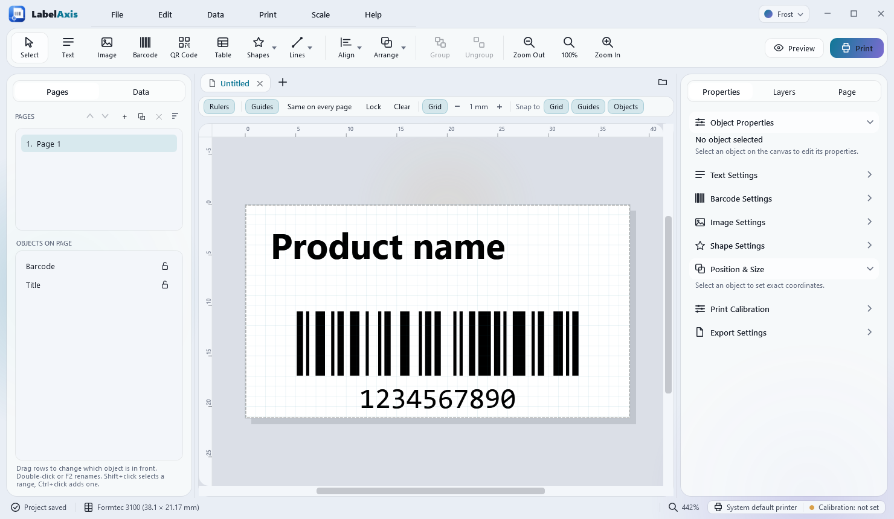
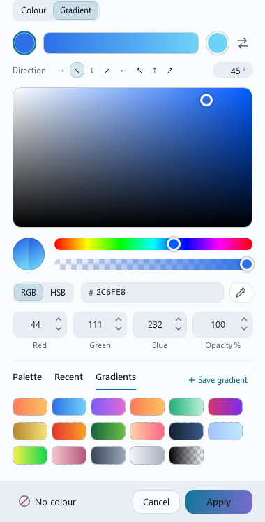
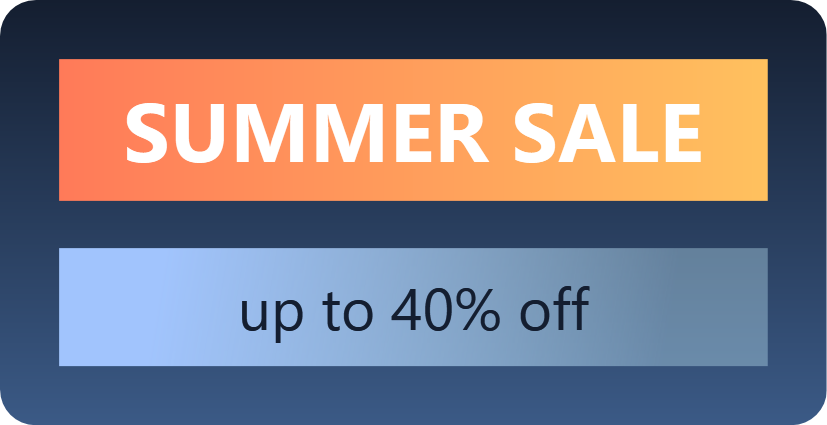
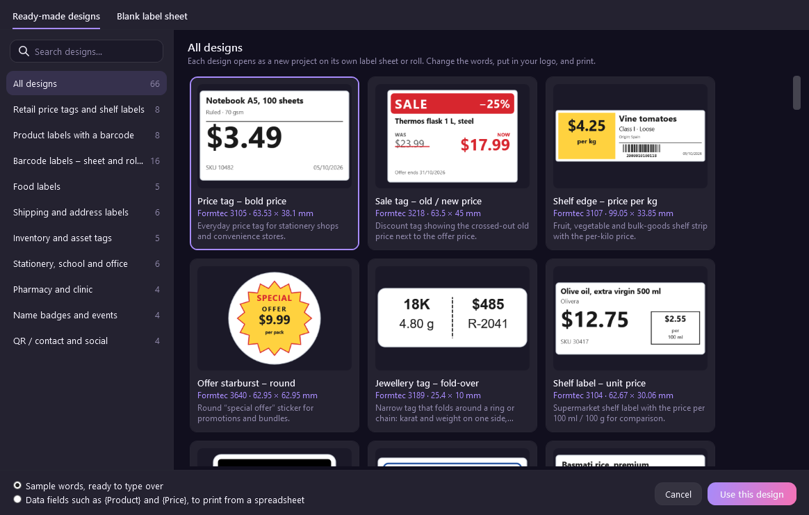
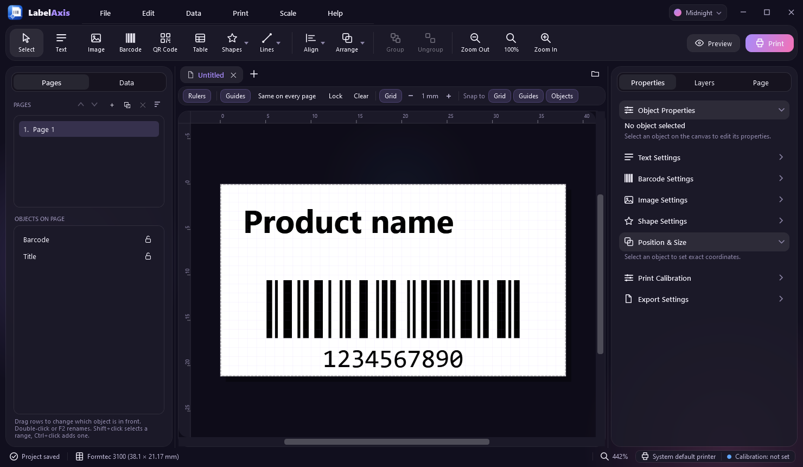

# LabelAxis

**Design, fill and print labels on Windows, accurate to the millimetre.**

LabelAxis is a free desktop program for designing labels, stickers, price tags and
barcodes and printing them on label sheets (Formtec, Avery or any size you measure),
thermal label printers, and office printers on the network. It fills labels from
spreadsheets and databases, handles Arabic and RTL texts, and has its own help
guide. The interface is in English, Arabic and Kurdish.



> **Download:** get the installer or the portable zip from the
> [Releases](../../releases/latest) page. Windows 10 (1809 or later) or Windows 11, 64-bit.

---

## Why LabelAxis

- **What you see is what prints.** The canvas, the print preview, PDF, pictures and the
  printer all draw through the same engine. A 40 × 20 mm label prints at 40 × 20 mm.
  Pages are never shrunk to fit unless you ask.
- **It lines up on your sheet.** There are 178 built-in label sheets and a calibration
  wizard that remembers each printer's offset, and you can start on any label of a
  part-used sheet.
- **Barcodes that scan.** LabelAxis has its own Code 128 / GS1-128 encoder and covers
  every common 1D and 2D symbology. Generated barcodes are checked by decoding them
  again in the automated tests.
- **Built for real runs.** Thousands of records print from one design, never one page
  per record, so big jobs stay fast.
- **Right-to-left support done properly.** RTL text shapes and displays correctly on
  screen, in PDFs, and in print, and the entire program can be shown in RTL languages.

---

## Features

### Designing

- Text boxes with mixed formatting (bold, italic, colour and size per word), alignment,
  line and letter spacing, padding, and text that grows the box or shrinks to fit.
- Images with fit modes, crop, crop to a shape, brightness / contrast, flip and borders.
- Shapes: rectangles, rounded boxes, circles, triangles, polygons, stars, bursts,
  lines, arrows. You can also draw your own shape dot by dot, with sharp or **curved**
  points.
- Tables, date and time fields, record and page numbers.
- Rulers, draggable guides, a grid, and snapping to guides, objects and the grid.
  Exact sizes in mm, cm, inches, points or pixels.
- Move, resize, rotate, slant, align, distribute, group, lock and layer. Full undo and
  redo.
- **Custom fonts:** add a font file once. It travels inside the project, so the label
  looks the same on another PC.
- A **colour window** with a colour field, hue and opacity sliders, hex codes, an
  eyedropper, a palette, recent colours, and **gradients**. You can blend any two colours
  at any angle, or start from 16 ready-made gradients.




### Your own designs

Save any page as one of **your own designs** (File › Save page as my design). It keeps its label
sheet, fonts, pictures and data connection, and is listed first in File › New Project, ready to
start next month's labels in two clicks.

### Ready-made designs

66 ready-made designs to start from, grouped by use:

- price tags and shelf labels;
- product, food, pharmacy, shipping and inventory labels;
- name badges, QR and contact cards.

Each opens with sample words, or with data fields such as `{Product}` and `{Price}` that
are ready for a spreadsheet. A **blank sheet** or a **custom size** is one tab away.



### Pages

- One project holds several label designs, called pages, numbered 1, 2, 3…
- Duplicate a page for each product and change only the words.
- **Apply page format** copies the size, position and look of every barcode, text box,
  image and shape to the other pages, matched by name or by order.
- **Find and replace** (`Ctrl+F` / `Ctrl+H`) searches:
  - text, barcode values, table cells, object names and **page names**;
  - one page or all of them.

  Pick a result to jump straight to it. Replace edits everything in one undo step.

### Barcodes and QR codes

- **1D:** Code 128 (automatic A/B/C), Code 128 A/B/C, GS1-128, Code 39, Code 93,
  EAN-13, EAN-8, UPC-A, UPC-E, ITF-14, Interleaved 2 of 5, Codabar, ISBN-13 and MSI.
- **2D:** QR Code, Data Matrix, PDF417 and Aztec.
- Every barcode is drawn as sharp vector bars at any size.
- Values are checked before anything prints.
- The **barcode image generator** saves one barcode as **PNG** (150–1200 dpi), **SVG** or
  **PDF**.
- The **bulk generator** writes a whole numbered series to a folder.
- The **GS1 barcode builder** makes GS1-128, GS1 DataMatrix and GS1 QR codes for food,
  medicines, medical devices (UDI) and shipping (SSCC):
  - pick what the label is for, then fill in each piece of data;
  - check digits, real dates, lengths and the GS1 rules about which data belong together are
    checked as you type, in plain words.
- **Check a printed barcode:** a webcam, a photo or a scan grades the barcode **A to F** the way a
  barcode verifier does (ISO/IEC 15416 and 15415):
  - contrast, modulation, defects, decodability, quiet zones and bar width, each graded;
  - what to change, for example lower the printer's darkness when bars print too wide;
  - whether it matches the barcode on your label.

### Data and variable labels

- Import CSV, TSV, TXT and Excel (`.xlsx`), paste from the clipboard, or type a table.
- Read from **SQLite, SQL Server, MySQL, PostgreSQL, Microsoft Access or ODBC**. Reads
  only: queries run read-only.
- Put `{Field}` tokens anywhere, including in barcode values.
- Safe formulas such as `"LOT-" + {Batch}`, `UPPER({Product})` and `FORMAT({Price},"0.00")`.
- Number sequences like `ABC000001…ABC010000` or `BOX-A-#####`.
- Choose which records to print, filter them and sort them.
- Import a **Microsoft Publisher** file to bring its text and layout across.

### Printing

- **Label sheets:** 178 Formtec sheets (the 3000 series and the whole GS-1xxx family)
  plus Avery. You can import more as JSON or CSV, or measure your own.
- Full print preview, copies per page, and a start position on part-used sheets with
  skipped labels.
- A **calibration wizard** stores the offset and scale for each printer.
- **Thermal printers:** prints in ZPL or TSPL through Windows, a network port, a COM
  port or Bluetooth.
- **Wi-Fi and network printers:** prints directly over IPP. Printers are found on the
  network for you.
- A print history so a jammed run can be reprinted from where it stopped.
- **Print requests from other programs:** a till, an online shop or a spreadsheet prints labels
  without anyone opening a window:
  - drop a `.json` request or a `.csv` list into a **watch folder**;
  - or send it to a **web link** on the PC (`POST http://localhost:8765/print`);
  - one label per record with one of your designs, printed or returned as a PDF;
  - web pages in a browser are refused, and other computers need an access key.

### Export

- Vector **PDF**, with fonts embedded and right-to-left text kept correct.
- **SVG**.
- **PNG** and **JPEG** at 300, 600 or any dpi.
- A **preflight check** before printing or exporting catches:
  - objects outside the label or the printable area;
  - missing images and fonts;
  - barcodes that will not scan, and duplicate barcodes;
  - low-resolution pictures and empty required fields.

### The program itself

- **Eight themes**, light and dark: Frost, Aurora, Midnight, Graphite, Ember, Ocean,
  Sakura and Sage.
- Interface in **English, العربية and کوردی (سۆرانی)**, laid out right to left for
  Arabic and Kurdish.
- Built-in, searchable help in all three languages.
- Several projects open in tabs. Autosave and crash recovery mean nothing is lost.
- Projects are single `.labelproj` files: a ZIP holding the design, images and fonts.
  Saving is atomic, so a crash cannot corrupt a file.
- Checks GitHub Releases for new versions and updates itself (once the build is pointed at
  the repository; see `docs/BUILD.md`).



---

## Install

| Download | Choose it when |
|---|---|
| `LabelAxis-Setup-<version>.exe` | You want the small installer. It uses Microsoft's .NET 10 Desktop Runtime and downloads that once if the PC lacks it. |
| `LabelAxis-Setup-<version>-Offline.exe` | The PC has no internet, or you install on many PCs. Everything is inside. |
| `LabelAxis-<version>-portable.zip` | Run it from any folder or a USB stick. Settings stay beside it. |

`SHA256SUMS.txt` beside the downloads lets you check the files.

---

## For developers

**Stack:** C# / .NET 10, WPF on Windows. The engine (`LabelMaker.Core`) is plain `net10.0`
with no UI dependency.

**Libraries:** ZXing.Net, PdfSharp, CsvHelper and ClosedXML.

**Tests:** 617 headless unit tests, including round-trip decoding of generated barcodes,
plus a click-through UI test suite.

```bash
# Prerequisites: .NET 10 SDK on Windows 10/11
dotnet build LabelMaker.slnx -c Release
dotnet test  tests/LabelMaker.Tests
dotnet run   --project src/LabelMaker.App        # start the designer
```

Packaging (installers, portable zip, update feed): [`docs/BUILD.md`](docs/BUILD.md).

### Command-line tool

`labelaxis` runs the engine without the window. It writes vector SVG and PDF; PNG needs
the desktop app.

```bash
labelaxis barcode --symbology code128 --value ABC001459 --out code.svg
labelaxis sequence --prefix PRD- --suffix -IRQ --start 1 --end 10000 --padding 6
labelaxis bulk-barcode --symbology code128 --prefix ABC --start 1 --end 10000 \
           --padding 6 --format svg --out ./out
labelaxis export --project labels.labelproj --data rows.csv --out sheet.pdf
labelaxis templates list
labelaxis preflight --project labels.labelproj --data rows.csv
labelaxis inspect --project labels.labelproj
```

### Repository layout

```
├─ LabelMaker.slnx                 solution
├─ Directory.Build.props           common settings and the version number
├─ Directory.Packages.props        pinned package versions
├─ docs/                           architecture, template schema, build, UI design, ideas
├─ templates/formtec/              label-sheet templates (data, not code)
├─ templates/designs/              the ready-made designs
├─ src/
│   ├─ LabelMaker.Core/            the engine: units, model, sheets, barcodes, data,
│   │                              variables, search, preflight, printing, rendering,
│   │                              saving, editing, localisation
│   ├─ LabelMaker.Export/          PDF and SVG drawing and exporters
│   ├─ LabelMaker.Data/            databases and Publisher import
│   ├─ LabelMaker.App/             the Windows program (LabelAxis.exe)
│   └─ LabelMaker.Cli/             the command-line tool (labelaxis.exe)
├─ tests/                          unit tests and UI tests
├─ installer/                      Inno Setup scripts
└─ build/                          build, test and release scripts
```

Further reading:

- [`docs/ARCHITECTURE.md`](docs/ARCHITECTURE.md): the overall design.
- [`docs/DEVELOPER.md`](docs/DEVELOPER.md): a map of the engine.
- [`docs/UI-DESIGN.md`](docs/UI-DESIGN.md): the look of the app.
- [`docs/TEMPLATE-SCHEMA.md`](docs/TEMPLATE-SCHEMA.md): the sheet file format.
- [`docs/OMISSIONS.md`](docs/OMISSIONS.md): what was left out on purpose.

### Priorities

When something has to give, in this order:

1. stability and data safety;
2. printing at the true size;
3. accurate label sheets;
4. reliable barcodes;
5. variable data;
6. saving and opening;
7. search;
8. easy design;
9. export.

A smaller program that always works beats a bigger one full of half-working features.

---

## Licence

MIT, see [`LICENSE`](LICENSE). Bundled libraries keep their own licences (see
[`THIRD-PARTY-NOTICES.txt`](THIRD-PARTY-NOTICES.txt)).
